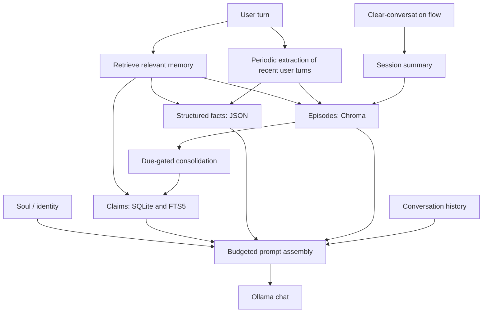

# Improving the current memory system on constrained local hardware

## Executive summary

The current system already has the essential pieces: always-on identity, structured facts, vector-searchable episodes, and a SQLite claims layer with provenance and contradiction handling. Its best near-term improvement is therefore not another database or a larger model, but making these existing pieces share resources and perform bounded, evidence-aware work.[^1][^2][^3] The highest-priority changes are to unify embedding ownership, make consolidation incremental and idempotent, retain query relevance in claim ranking, and align application context budgets with the actual Ollama request.[^4][^5][^6][^7] Keep Chroma initially; consider a SQLite-centered deployment only if measurements on the target machine justify migration.[^8][^9] No performance benchmarks were run for this report, and the repository's Raspberry Pi deployment is a planned target rather than a verified operating environment.[^10]

## Scope and method

**Question type:** technical deep dive with a prioritized improvement plan.

Six focused research dispatches covered implementation, deployment constraints, lightweight retrieval alternatives, code-path verification, memory lifecycle, and Ollama/resource evaluation. Repository source and tests were inspected read-only; external claims were checked against first-party documentation and original research. Recommendations below are proposals, not implemented changes.

**Interpretation:** "memory" means the assistant's persistent knowledge and retrieval system, while also considering its RAM, storage, inference, and context-window costs. The report intentionally excludes personal memory contents.

The repository snapshot reported by researchers was `382ebae0372e34688ed9fd0ed6e1a8d1087fba6e`. Code citations use that snapshot; it is a reference point, not a claim that every cited feature originated in that commit.

## 1. Current architecture

### Key repositories and primary resources

| Resource | Role in this report |
|---|---|
| [danielbsimpson/personal_robot](https://github.com/danielbsimpson/personal_robot) | Current implementation and deployment plans |
| [chroma-core/chroma](https://github.com/chroma-core/chroma) | Existing embedded vector database |
| [asg017/sqlite-vec](https://github.com/asg017/sqlite-vec) | Optional lightweight vector-search extension |
| [ollama/ollama](https://github.com/ollama/ollama) | Local model serving and resource controls |
| [UKPLab/sentence-transformers](https://github.com/UKPLab/sentence-transformers) | Current embedding runtime and optional optimized backends |

### Existing components

| Layer | Current mechanism | Main improvement opportunity |
|---|---|---|
| Identity / soul | YAML-backed identity included in the system prompt | Keep its prompt allocation bounded and distinguish identity from retrieved evidence |
| Structured facts | JSON storage with category/keyword retrieval | Avoid unnecessary repeated file parsing; preserve compatible behavior |
| Episodes | Chroma persistent collection with MiniLM embeddings | Share the embedding runtime; avoid full-corpus consolidation reads |
| Claims | SQLite, embeddings, FTS5, confidence, reinforcement, validity, contradictions | Correct evidence accounting and ranking before optimizing scan performance |
| Context assembly | Claims, facts, and episodes receive bounded prompt allocations | Use one coherent budget that also reaches Ollama |

These are implemented layers, not a proposal for a new architecture.[^1][^2][^3][^6]



The Streamlit integration retrieves claims, facts, and episodes before generation. Extraction runs periodically over recent user messages, while session-end summarization and consolidation are connected to UI actions.[^1][^11] A due gate is not an autonomous scheduler: it controls whether an invoked run proceeds.[^5]

### Hardware context

The repository documents an RTX 4060 laptop with 8 GB VRAM as the development environment and a Raspberry Pi 5 with 8 GB system RAM as a future target. These are materially different operating conditions; the Pi cannot inherit laptop context sizes, model choices, or background concurrency assumptions without measurement.[^10]

The research did not establish available RAM, actual process residency, or active Ollama server overrides. Treat deployment recommendations below as candidate configurations, not descriptions of the running machine.

## 2. Priority order

The ordering below is an engineering recommendation based on the verified paths, not a measured ranking of speedups.[^4][^5][^6][^7][^12]

| Priority | Change | Expected benefit | Main verification |
|---|---|---|---|
| P0 | Incremental, idempotent consolidation | Prevent repeated work and artificial reinforcement | Replaying the same evidence changes neither trust nor claim count |
| P0 | Unify context configuration and request payload | Avoid budgeting for context the server was never asked to provide | Wire-contract test plus long-prompt integration test |
| P1 | Share one embedding runtime | Remove duplicate model ownership | One model load for both stores; measure process RSS |
| P1 | Preserve relevance in ranking; apply full validity interval | Improve useful recall without larger models | Ranking, expired/future-valid, and update tests |
| P1 | Serialize background inference and bound jobs | Control contention and recovery | Foreground latency under background work; interrupted-job replay |
| P2 | Hybrid lexical/vector retrieval and cached vector decoding | Improve exact recall and reduce avoidable CPU work | Recall@k, precision@k, p95 retrieval time |
| P2 | Retention and deletion propagation | Bound growth and make forgetting coherent | Deleted evidence cannot reappear through derived stores |
| P3 | ONNX/int8 embeddings or SQLite-centered storage | Potential deployment savings | Target-platform compatibility and quality/resource comparison |

## 3. Share embeddings before changing databases

### Observed problem

The episode store constructs Chroma's `SentenceTransformerEmbeddingFunction`, while the claims store uses the project's `Embedder` and its separate model cache. Both target the same MiniLM family, but the application does not route them through one shared ownership mechanism.[^4]

The existing cache helper illustrates the mechanism to reuse:

```python
def _load_model(model_name: str):
    """Return a cached SentenceTransformer for *model_name*, loading if needed."""
    if model_name not in _model_cache:
        with _cache_lock:
            if model_name not in _model_cache:
                from sentence_transformers import SentenceTransformer
                _model_cache[model_name] = SentenceTransformer(model_name, device=_DEVICE)
    return _model_cache[model_name]
```

This is existing code, not a proposed replacement.[^13]

### Recommended design

Route both stores through one embedding service or a compatible Chroma adapter backed by the existing cache. Compute each query embedding once where API contracts permit and pass it to both retrieval paths. Cache immutable memory embeddings at write time rather than repeatedly encoding unchanged text. Preserve model identity, normalization, dimensionality, and distance semantics; reindex if those change.[^4][^8][^13]

Do not promise a specific RAM reduction: removing duplicate model ownership does not halve the whole process, which also includes framework, database, text, and inference overhead. Verify load counts and process RSS before and after.

### Optional second step: optimized CPU inference

Sentence Transformers supports ONNX and OpenVINO alternatives to its default PyTorch backend, and upstream MiniLM artifacts include architecture-specific quantized ONNX variants. Test an ARM64-compatible ONNX/int8 path on the Pi only after eliminating duplicate loading.[^14][^15]

The model's 384-dimensional outputs are documented, but vector dimension, model download size, parameter count, and resident memory are different quantities. Do not treat the repository's compact model-size estimate as a measured runtime footprint.[^15]

## 4. Make consolidation bounded, incremental, and evidence-aware

### Observed problems

Consolidation reads the entire episode collection and joins it into one prompt. Its interval and minimum-episode gates limit invocation frequency, not the amount of work performed per run.[^5]

The existing helper is unbounded:

```python
def _get_all_episodes(self) -> list[dict]:
    """Return all documents from MemoryStore as {id, text} dicts."""
    if self._memory is None:
        return []
    return self._memory.get_all_memories()
```

This is existing code.[^5]

Repeated extraction of the same claim can increment reinforcement even when its episode IDs are already recorded. Consequently, reprocessing old evidence can make a claim appear better corroborated without new supporting evidence.[^12]

Contradiction checking can issue up to three sequential model calls per candidate claim. Extraction also calls the model separately for recent user turns; running every fifth turn does not imply only one inference call per pass.[^11][^16]

### Recommended pipeline

1. Select **unprocessed episode versions**, not the whole corpus.
2. Limit each job by input tokens and episode count.
3. Extract a bounded batch of candidates.
4. Perform deterministic normalization and deduplication first.
5. Shortlist possible conflicts using cheap retrieval.
6. Batch genuinely ambiguous comparisons where output validation remains reliable.
7. Commit claims, evidence links, and completion state together.
8. Retry failed work explicitly; do not mark a partially failed batch fully processed.

These steps address the observed full-corpus reads, repeated reinforcement, per-pair inference, and partial-failure reporting.[^5][^12][^16][^17]

### Proposed minimal durable state

The following is a design sketch, not the current schema:

```sql
CREATE TABLE processed_episode_versions (
    episode_id TEXT NOT NULL,
    content_hash TEXT NOT NULL,
    processed_at TEXT NOT NULL,
    PRIMARY KEY (episode_id, content_hash)
);

CREATE TABLE claim_evidence (
    claim_id TEXT NOT NULL,
    episode_id TEXT NOT NULL,
    content_hash TEXT NOT NULL,
    PRIMARY KEY (claim_id, episode_id, content_hash)
);

CREATE TABLE memory_jobs (
    job_id TEXT PRIMARY KEY,
    status TEXT NOT NULL,
    lease_until TEXT,
    attempts INTEGER NOT NULL DEFAULT 0,
    last_error TEXT
);
```

A content hash lets edited episodes be processed again without treating identical replays as fresh evidence. Reinforcement should reflect distinct supporting evidence, with additional provenance rules where multiple summaries derive from the same original conversation. This follows directly from the current replay problem; counting unique rows alone is not proof of independent corroboration.[^12]

### Concurrency and recovery

The current daemon-thread launcher lacks an atomic cross-run claim on work. Use a short transaction to acquire a durable job lease, release the transaction while inference runs, then use a short transaction to commit results and completion state. Do **not** hold a SQLite write transaction across model generation.[^17][^18]

WAL helps readers and a writer coexist, but does not permit unlimited concurrent writers. Configure bounded busy handling and report exhausted retries; a timeout alone is not a job scheduler or a correctness guarantee.[^18][^19]

Start with one background inference worker and foreground priority. A separate smaller extraction model is optional: it may improve extraction cost but can also add another resident model or trigger model swapping. Creating a new Python `OllamaClient` does not itself reload model weights; server residency and resource availability determine that behavior.[^16][^20]

## 5. Improve retrieval quality without increasing model size

### 5.1 Preserve relevance after filtering

Claims currently use similarity to decide inclusion, then sort surviving results by trust. Semantic relevance is therefore discarded from the final ordering.[^21]

Use semantic/lexical relevance as the primary signal and confidence, evidence support, and freshness as bounded adjustments. Avoid directly adding an unbounded reinforcement-derived trust value to cosine similarity. For hybrid retrieval, rank-based fusion is a candidate design, but weights and cutoffs must be evaluated on this corpus rather than presented as universal constants.[^21][^22]

### 5.2 Search lexical and semantic signals together

FTS5 is currently a fallback when vector retrieval finds no matches. That can miss an exact entity or identifier match whenever any weaker semantic result clears the vector threshold.[^2][^21]

Retrieve small candidate sets from both paths, deduplicate by claim ID, and fuse their rankings. SQLite FTS5 provides BM25; its scores are ordered with **lower values better**, so they must not be treated as positive cosine scores.[^22]

Use:

- lexical retrieval for exact names, identifiers, and distinctive phrases;
- semantic retrieval for paraphrases;
- explicit validity filters before final selection;
- diversity/deduplication so repeated statements do not consume the entire prompt budget.

This is a proposed retrieval policy based on the existing fallback design and the two retrieval mechanisms, not a measured quality improvement.[^2][^21][^22]

### 5.3 Separate truth, age, and relevance

The current trust formula multiplies confidence and reinforcement by an exponential decay with a 30-day scale. The same decay applies without distinguishing stable facts from time-sensitive state.[^23]

Use explicit validity and supersession for changes in truth. Apply freshness preferences according to memory type rather than treating an old statement as intrinsically unreliable. Stable identity facts, current task state, and episodic details should not automatically share one expiration policy.[^23][^24]

Also enforce both ends of the validity interval: the current retrieval filter checks `valid_until` but does not enforce `valid_from`. A future-valid claim should not be returned as currently applicable.[^24]

### 5.4 Optimize scans only when necessary

Claims currently fetch active rows, decode JSON embeddings, and calculate similarity in Python on each query. This is avoidable repeated work, but a small corpus does not automatically require ANN.[^2]

First compare:

1. Existing implementation.
2. Cached, normalized, contiguous float32 vectors with explicit invalidation.
3. A SQLite vector extension.
4. Existing Chroma infrastructure reused for claim vectors, with SQLite remaining authoritative for provenance and validity.

A lexical-only prefilter can reduce work but also remove semantic-only matches; evaluate that recall tradeoff rather than assuming it is safe.[^2][^8][^9][^22]

## 6. Align prompt budgets with actual inference

### Observed mismatch

`ContextBudget` defaults to 8,192 tokens with a 512-token response reserve and a character-based token approximation. The client also has a separate history-trimming limit, while its request builder does not send `options.num_ctx`.[^6][^7]

The actual request builder:

```python
def _build_payload(self, messages: list[dict], stream: bool) -> dict:
    """Prepend system prompt and return the full request payload."""
    system_message = {"role": "system", "content": self.system_prompt}
    full_messages = [system_message] + messages
    return {
        "model": self.model,
        "messages": full_messages,
        "stream": stream,
    }
```

This is existing code.[^7]

Ollama supports explicit context configuration; omission means the application relies on external server/model defaults that repository source alone cannot establish.[^25]

### Recommended contract

Choose one context capacity and use it in both prompt assembly and the request. This is an illustrative proposed wire shape:

```json
{
  "model": "<selected-model>",
  "messages": [],
  "stream": true,
  "options": {
    "num_ctx": 4096,
    "num_predict": 512
  }
}
```

The numbers are example settings, not measured optimum values. Account for system instructions, identity, history, retrieved memory, formatting/chat-template overhead, output allowance, and safety margin within the chosen capacity.[^6][^25]

Do not automatically increase server context to match 8,192: lowering the application budget may be the better constrained-hardware choice. Use the actual model tokenizer/chat template where practical; an unrelated tokenizer is not an exact replacement for the current character heuristic.[^6][^25]

Initially preserve the existing section allocations while aligning the contract. Adaptive borrowing between unused allocations can be evaluated later, separately from this correctness change.

## 7. Storage choices and realistic memory arithmetic

### Options

| Option | Suitable use | Important limitation |
|---|---|---|
| Existing Chroma plus shared embedder | Lowest-risk near-term improvement | Does not itself fix claims' Python scan or lifecycle problems |
| SQLite FTS5 alone | Minimal semantic-model overhead; strong exact lexical retrieval | Does not provide semantic paraphrase matching |
| SQLite plus cached vector matrix | Small corpora and simple exact search | Application owns invalidation and scan efficiency |
| SQLite plus sqlite-vec | Consolidated local persistence and native vector operations | Pre-v1 compatibility and platform/extension loading must be checked |
| Chroma for episodes and claim-vector candidates | Reuse an existing vector engine | Synchronization with authoritative SQLite state must be explicit |

FTS5's BM25 and sqlite-vec's vector operations are documented by their maintainers. The researched non-alpha sqlite-vec path uses exact KNN; do not equate adding it with obtaining ANN. Release status and platform support must be rechecked when choosing a version.[^8][^9][^22]

### Raw vector storage only

For 384-dimensional vectors:

`raw bytes = number of vectors * 384 * bytes per component`

| Vectors | float32 | int8 |
|---:|---:|---:|
| 1,000 | 1.46 MiB | 0.37 MiB |
| 10,000 | 14.65 MiB | 3.66 MiB |
| 100,000 | 146.48 MiB | 36.62 MiB |

These are arithmetic estimates, not process-RAM or database-size measurements. They exclude text, metadata, model weights, Python objects, indexes, caches, temporary allocations, and the operating system. The model's dimension and sqlite-vec's supported representations are documented; int8 requires a compatible quantization/search path and quality validation.[^9][^15]

Thus, at modest corpus sizes, eliminate avoidable model and inference costs before assuming raw vector storage requires a database migration. Whether exact scanning is fast enough remains a target-machine measurement, not a conclusion from size arithmetic alone.[^2][^4][^5]

Do not add a graph database or neural reranker until an evaluation set demonstrates failures simpler retrieval cannot resolve. Additional extraction, storage, and inference stages should earn their resource cost through measured improvement.[^26]

## 8. Retention and coherent forgetting

Claims currently support soft expiration and contradiction markers. Episode clearing is all-or-nothing, while claim provenance can continue referencing removed episode IDs; a complete cross-store deletion workflow is absent.[^27]

Add a deletion workflow that:

1. Identifies source and derived records.
2. Removes or invalidates affected claims, facts, episodes, and cached embeddings.
3. Updates FTS/vector indexes and evidence links.
4. Prevents deleted evidence from being re-imported during replay.
5. Handles backups and rebuild inputs according to an explicit retention policy.
6. Records operational completion without copying forgotten content into new logs.

These are proposed requirements addressing the observed disconnected deletion surfaces.[^27]

For storage limits, distinguish "not normally retrieved" from "physically deleted." Keep retention policy configurable by memory type; do not delete stable knowledge merely because it has not recently been retrieved. Bound episode growth through documented limits and reviewed summarization/compaction rather than silent pruning.[^23][^27]

## 9. Hardware-specific deployment approach

All settings here are **initial experiments**, not certified profiles.[^10][^20][^25]

| Scenario | Initial approach | Change only after measurement |
|---|---|---|
| Documented RTX 4060 laptop | Keep Chroma; share CPU embedder; align explicit context; serialize background inference | Larger context, model concurrency, KV-cache changes |
| Planned Pi 5 8 GB | One generative model at a time; test 2K then 4K context; bound jobs; consider ONNX/int8 embeddings | Storage migration or increased context |
| Hypothetical tighter RAM-only system | FTS-first retrieval; semantic lookup enabled only if it fits measured budgets | Extra models, rerankers, graph extraction |

Ollama exposes model residency through `keep_alive` and server controls for loaded models, parallel requests, and queueing. Longer residency reduces avoidable cold starts only when memory permits; unloading frees resources but moves cost to the next load.[^20]

Parallel model requests increase context-memory requirements. Application-level foreground priority is still needed; server queueing does not automatically prioritize interactive chat over consolidation.[^20]

KV-cache quantization is a later experiment, not the first fix. The documented options have quality and backend requirements; verify Flash Attention support and the selected model/backend before applying them to a Pi or laptop configuration.[^20]

## 10. Verification and staged rollout

The repository contains functional memory, context, embeddings, claims, and consolidation tests, but the research did not establish a representative retrieval-quality or target-hardware performance benchmark. Extend existing tests before adding broad new infrastructure.[^28]

### Test matrix

Use synthetic memory fixtures, not a required export of personal conversations.

| Area | Cases | Required result or metric |
|---|---|---|
| Extraction | Repeated messages, paraphrases, rejected/transient candidates | Durable facts retained; rejected content stays rejected |
| Idempotency | Same episode/version replayed repeatedly | No new evidence, claim, or reinforcement from identical replay |
| Updates | Corrections, equal-confidence conflicts, temporal changes | Current answer correct; ambiguity preserved where unresolved |
| Validity | Before `valid_from`, within interval, after `valid_until` | Only applicable evidence retrieved |
| Retrieval | Exact identifiers, paraphrases, irrelevant queries | Recall@k, precision@k, abstention correctness |
| Jobs | Concurrent triggers, failure mid-batch, restart | Single claimed job; safe retry; visible partial failures |
| Deletion | Delete source, derived claim, then rebuild/replay | Forgotten material does not return |
| Context | Long history, Unicode, code-heavy messages | Request configuration and assembled budget agree |
| Resources | Cold/warm queries; background worker active | p50/p95 latency, RSS, VRAM, swap activity |
| Scale | 1K, 10K, 100K synthetic memories | Time, memory, and quality growth documented |

The correctness cases follow the verified code risks; evaluation dimensions such as temporal reasoning, knowledge updates, multi-session reasoning, and abstention are also supported by LongMemEval and LoCoMo.[^12][^17][^21][^24][^26][^27]

### Proposed acceptance gates

These are engineering targets to adopt or revise after baseline measurement:

- **Correctness:** all replay, validity, deletion, and failure-reporting tests pass.
- **Embedding ownership:** exactly one intended runtime instance for the shared model.
- **Quality:** no regression on mandatory synthetic cases; report aggregate metrics and failures, not only an average.
- **Responsiveness:** measure foreground p95 with and without background work; initially reject changes exceeding a 10% regression unless explicitly traded for demonstrated quality.
- **Memory:** record peak total working-set pressure under representative concurrent features; require operating-system headroom and no sustained swap thrashing.
- **Persistence:** restart/replay produces the same committed evidence state.

The 10% gate is a proposed threshold, not a researched universal standard. No specific millisecond latency, Pi token rate, or RAM saving is claimed.

### Implementation sequence

1. **Baseline and contracts:** add timing/resource instrumentation, synthetic fixtures, payload tests, and current-behavior regression coverage.
2. **Correctness:** introduce evidence idempotency, job leases, visible partial failures, and validity/ranking fixes.
3. **Low-risk resource savings:** share embeddings, bound consolidation, serialize background inference, and align context configuration.
4. **Quality tuning:** compare lexical/vector fusion and threshold choices.
5. **Deployment optimization:** benchmark ONNX/int8 and SQLite alternatives on the actual Pi image.
6. **Migration only if justified:** back up, preserve IDs/provenance, rebuild embeddings/indexes, compare retrieval outputs, and retain a tested rollback path.

This sequence is a recommendation derived from the observed implementation and documented deployment constraints, not a claim that later optimizations will necessarily outperform the current stack.[^4][^5][^7][^9][^10][^12]

## 11. Confidence assessment

**High confidence:** the inspected application has separate embedding ownership paths; full-corpus consolidation; repeat-reinforcement risk; trust-only final ordering after similarity filtering; incomplete validity filtering; and a request payload that omits explicit context configuration. These findings are grounded in implementation rather than README claims.[^2][^4][^5][^7][^12][^21][^24]

**Moderate confidence:** shared embedding ownership and incremental consolidation are the best first resource optimizations. Their structural benefits are clear, but actual savings depend on workload, initialization paths, corpus size, and hardware; no timings or memory profiles were collected.

**Not established:** actual server context defaults/overrides, current available RAM, concurrent workload, Pi deployment viability, exact resident embedding memory, or whether a SQLite migration beats Chroma on this application. Documentation about current upstream releases may differ from installed dependency behavior.

**Assumptions:** a mostly single-user local assistant, no cloud-memory requirement, bounded background work, and preservation of existing memory UX. The Pi is treated as planned hardware, and a tighter-RAM scenario is hypothetical.

**Corrections to preliminary research:** extraction examines multiple recent user messages rather than only one message; creating an HTTP client is not proof of model reload; a due gate is not a scheduler; and storage occupancy cannot prove whether consolidation is operationally correct. No conclusion in this report relies on inspecting personal memory contents.[^5][^11][^16][^20]

## Footnotes

[^1]: [danielbsimpson/personal_robot, src/app.py:332-380 and 519-533](https://github.com/danielbsimpson/personal_robot/blob/382ebae0372e34688ed9fd0ed6e1a8d1087fba6e/src/app.py#L332-L380); [session-end integration](https://github.com/danielbsimpson/personal_robot/blob/382ebae0372e34688ed9fd0ed6e1a8d1087fba6e/src/app.py#L519-L533).
[^2]: [src/memory/claims.py:341-434, retrieval, full-row scan, vector filtering, and FTS fallback](https://github.com/danielbsimpson/personal_robot/blob/382ebae0372e34688ed9fd0ed6e1a8d1087fba6e/src/memory/claims.py#L341-L434).
[^3]: [src/memory/facts_store.py:140-357](https://github.com/danielbsimpson/personal_robot/blob/382ebae0372e34688ed9fd0ed6e1a8d1087fba6e/src/memory/facts_store.py#L140-L357); [src/memory/vector_store.py:61-101](https://github.com/danielbsimpson/personal_robot/blob/382ebae0372e34688ed9fd0ed6e1a8d1087fba6e/src/memory/vector_store.py#L61-L101).
[^4]: [src/memory/vector_store.py:95-101, Chroma embedding-function construction](https://github.com/danielbsimpson/personal_robot/blob/382ebae0372e34688ed9fd0ed6e1a8d1087fba6e/src/memory/vector_store.py#L95-L101); [src/memory/claims.py:160-187, separate embedder path](https://github.com/danielbsimpson/personal_robot/blob/382ebae0372e34688ed9fd0ed6e1a8d1087fba6e/src/memory/claims.py#L160-L187).
[^5]: [src/memory/consolidation.py:85-228, consolidation and due-gated execution](https://github.com/danielbsimpson/personal_robot/blob/382ebae0372e34688ed9fd0ed6e1a8d1087fba6e/src/memory/consolidation.py#L85-L228); [src/memory/consolidation.py:359-364, full-episode helper](https://github.com/danielbsimpson/personal_robot/blob/382ebae0372e34688ed9fd0ed6e1a8d1087fba6e/src/memory/consolidation.py#L359-L364); [src/memory/vector_store.py:226-241, collection read](https://github.com/danielbsimpson/personal_robot/blob/382ebae0372e34688ed9fd0ed6e1a8d1087fba6e/src/memory/vector_store.py#L226-L241).
[^6]: [src/llm/context.py:22-120, approximate token counter and context budget](https://github.com/danielbsimpson/personal_robot/blob/382ebae0372e34688ed9fd0ed6e1a8d1087fba6e/src/llm/context.py#L22-L120).
[^7]: [src/llm/client.py:89-97, request payload](https://github.com/danielbsimpson/personal_robot/blob/382ebae0372e34688ed9fd0ed6e1a8d1087fba6e/src/llm/client.py#L89-L97); [src/llm/client.py:132-136, history trimming](https://github.com/danielbsimpson/personal_robot/blob/382ebae0372e34688ed9fd0ed6e1a8d1087fba6e/src/llm/client.py#L132-L136).
[^8]: [Chroma official client documentation](https://docs.trychroma.com/docs/run-chroma/clients); [collection/index configuration](https://docs.trychroma.com/docs/collections/configure).
[^9]: [asg017/sqlite-vec official repository](https://github.com/asg017/sqlite-vec); [vec0 features and vector types](https://alexgarcia.xyz/sqlite-vec/features/vec0.html); [release history](https://github.com/asg017/sqlite-vec/releases); [installation](https://alexgarcia.xyz/sqlite-vec/installation.html).
[^10]: [README.md:256-287, laptop and Pi hardware tiers](https://github.com/danielbsimpson/personal_robot/blob/382ebae0372e34688ed9fd0ed6e1a8d1087fba6e/README.md#L256-L287); [TODO.md:666-730, planned Pi deployment](https://github.com/danielbsimpson/personal_robot/blob/382ebae0372e34688ed9fd0ed6e1a8d1087fba6e/TODO.md#L666-L730).
[^11]: [src/memory/extractor.py:24-26, cadence](https://github.com/danielbsimpson/personal_robot/blob/382ebae0372e34688ed9fd0ed6e1a8d1087fba6e/src/memory/extractor.py#L24-L26); [src/memory/extractor.py:208-246, recent-message worker](https://github.com/danielbsimpson/personal_robot/blob/382ebae0372e34688ed9fd0ed6e1a8d1087fba6e/src/memory/extractor.py#L208-L246).
[^12]: [src/memory/claims.py:210-258, evidence merge and reinforcement updates](https://github.com/danielbsimpson/personal_robot/blob/382ebae0372e34688ed9fd0ed6e1a8d1087fba6e/src/memory/claims.py#L210-L258), read with the full-corpus consolidation path in footnote 5.
[^13]: [src/memory/embeddings.py:38-55, shared cache and loader](https://github.com/danielbsimpson/personal_robot/blob/382ebae0372e34688ed9fd0ed6e1a8d1087fba6e/src/memory/embeddings.py#L38-L55).
[^14]: [Sentence Transformers official efficiency documentation, PyTorch/ONNX/OpenVINO and optimization](https://sbert.net/docs/sentence_transformer/usage/efficiency.html).
[^15]: [Official sentence-transformers/all-MiniLM-L6-v2 model card](https://huggingface.co/sentence-transformers/all-MiniLM-L6-v2); [upstream ONNX artifacts](https://huggingface.co/sentence-transformers/all-MiniLM-L6-v2/tree/main/onnx).
[^16]: [src/memory/consolidation.py:244-320, contradiction comparison path](https://github.com/danielbsimpson/personal_robot/blob/382ebae0372e34688ed9fd0ed6e1a8d1087fba6e/src/memory/consolidation.py#L244-L320); [src/llm/client.py:42-51, client initialization](https://github.com/danielbsimpson/personal_robot/blob/382ebae0372e34688ed9fd0ed6e1a8d1087fba6e/src/llm/client.py#L42-L51).
[^17]: [src/memory/consolidation.py:160-241, write results and asynchronous launching](https://github.com/danielbsimpson/personal_robot/blob/382ebae0372e34688ed9fd0ed6e1a8d1087fba6e/src/memory/consolidation.py#L160-L241); [src/memory/consolidation.py:295-357, due-state access](https://github.com/danielbsimpson/personal_robot/blob/382ebae0372e34688ed9fd0ed6e1a8d1087fba6e/src/memory/consolidation.py#L295-L357).
[^18]: [SQLite official WAL documentation](https://sqlite.org/wal.html); [transaction documentation](https://sqlite.org/lang_transaction.html).
[^19]: [SQLite PRAGMA busy_timeout documentation](https://sqlite.org/pragma.html#pragma_busy_timeout).
[^20]: [Ollama official FAQ: model residency, concurrency, queues, and KV-cache settings](https://docs.ollama.com/faq).
[^21]: [src/memory/claims.py:376-434, similarity gating and final trust ordering](https://github.com/danielbsimpson/personal_robot/blob/382ebae0372e34688ed9fd0ed6e1a8d1087fba6e/src/memory/claims.py#L376-L434).
[^22]: [SQLite FTS5 official documentation, BM25 and ranking](https://sqlite.org/fts5.html#the_bm25_function).
[^23]: [src/memory/claims.py:116-134, trust score](https://github.com/danielbsimpson/personal_robot/blob/382ebae0372e34688ed9fd0ed6e1a8d1087fba6e/src/memory/claims.py#L116-L134); [src/memory/claims.py:439-494, decay reporting](https://github.com/danielbsimpson/personal_robot/blob/382ebae0372e34688ed9fd0ed6e1a8d1087fba6e/src/memory/claims.py#L439-L494).
[^24]: [src/memory/claims.py:53-75, validity schema](https://github.com/danielbsimpson/personal_robot/blob/382ebae0372e34688ed9fd0ed6e1a8d1087fba6e/src/memory/claims.py#L53-L75); [src/memory/claims.py:341-390, validity filtering](https://github.com/danielbsimpson/personal_robot/blob/382ebae0372e34688ed9fd0ed6e1a8d1087fba6e/src/memory/claims.py#L341-L390).
[^25]: [Ollama official context-length documentation](https://docs.ollama.com/context-length); [Modelfile parameters, including num_ctx and num_predict](https://docs.ollama.com/modelfile); [official API documentation](https://github.com/ollama/ollama/blob/main/docs/api.md).
[^26]: [LongMemEval original paper, memory abilities and indexing/retrieval/reading evaluation](https://arxiv.org/abs/2410.10813); [LoCoMo original paper, long-term conversational memory evaluation](https://arxiv.org/abs/2402.17753). These inform evaluation design, not a claim that their published scores transfer to this robot.
[^27]: [src/memory/claims.py:296-339, contradiction and expiration](https://github.com/danielbsimpson/personal_robot/blob/382ebae0372e34688ed9fd0ed6e1a8d1087fba6e/src/memory/claims.py#L296-L339); [src/memory/vector_store.py:210-219, collection clearing](https://github.com/danielbsimpson/personal_robot/blob/382ebae0372e34688ed9fd0ed6e1a8d1087fba6e/src/memory/vector_store.py#L210-L219); source-ID handling in footnote 12. The absence of coordinated deletion is a repository-inspection finding, not something proven by one individual function.
[^28]: Repository-inspection findings from the memory architecture and deployment research dispatches; representative exact test: [tests/test_consolidation.py:230-231, nonblocking-launch timing check](https://github.com/danielbsimpson/personal_robot/blob/382ebae0372e34688ed9fd0ed6e1a8d1087fba6e/tests/test_consolidation.py#L230-L231). Broader test-suite quality/performance coverage was assessed statically; tests were not run.
